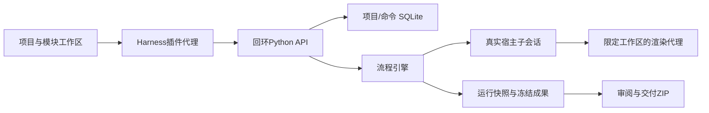

# 架构与维护约定

wf_projects保存稳定项目身份、归属、幂等受理、当前工作/交付和替代关系；wf_commands保存执行队列与租约。原JSON/JSONL仍是各运行的执行权威，媒体独立存盘，没有第二套影子运行状态。

运行冻结流程和模块定义；Generation是成果修订，Attempt是同一目标版本的执行尝试。会话ID独立于代次，host-sessions保存父子绑定、观察游标、继续关系。公开事件不包括隐藏推理；原生修改由wf_external检测、登记和按新代次/hash审阅。

wf_overview聚合当前工作，历史待办不自动当当前阻塞，也不按时间删除；替代关系由使用者明确设置。当前交付可仍指向旧版，修订不覆盖它。知识采用在wf_knowledge/kb中保留来源、版本、范围和片段定位，历史上下文不会因后来编辑而改写。

后端仅监听回环，JSON/写入使用实例令牌；健康检查公开但不含令牌。原生媒体用单资源、只读、1小时有效的签名地址，支持HTTP Range；日志移除媒体签名。宿主代理按实际端口及build身份定位，不把其他数据目录的实例误当本实例。每个数据目录按一个活动宿主/profile使用。

wf_environment只发现并保存使用者选择的工具路径，不自动购买或下载安装服务。节点显式声明video.remotion能力，当前尝试记录采用配置摘要。渲染票据限定工作区和当前轮次；不宣称完整OS沙箱。

wf_sharing只导入AI定义与主动选择的项目资料，生成独立模块ID，不覆盖用户定义或自动运行；路径、链接、大小与SHA先校验。wf_diagnostics默认只有版本、系统和状态计数，完全在本机生成。
